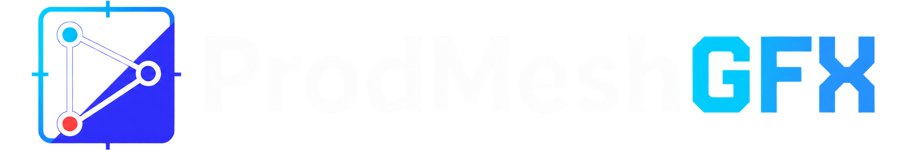

# ProdMesh Graphics

A distributed graphics design, programming, and playout system for templated
keyed broadcast content.

Design a **Template** in the browser. Bind data to it as an **Item**. Arrange
Items into **Playlists**, and Playlists into a **Rundown**. Take them on air.
**Playout Nodes** render them to SDI or NDI with key and fill, and a GPU display
output is designed in.

The North Star: **the operator simplicity of ProPresenter, with the authoring
stability, performance, and maturity of Ross Xpression or Vizrt.**

It is part of the ProdMesh family, alongside
[ProdMesh-Control](https://github.com/prodmesh), prodmesh-caption and
prodmesh-rta: tools built for a real church production booth, published openly
and offered in goodwill.

---

> ### Status: M6, and running real services in rehearsal
>
> Milestones M0–M5 are complete and M6 is under way. A designer builds a
> template in the browser, an operator binds data and runs a rundown, and a
> node puts it on air over SDI or NDI at 1080p59.94 with zero late frames.
> Development and every measurement so far are on **macOS with Metal**; Windows
> and Linux nodes are designed for and untested.
>
> **[docs/STATE.md](docs/STATE.md)** is what is actually real, with the
> measurements. **[docs/ROADMAP.md](docs/ROADMAP.md)** is what comes next.

---

## What works today

- **Design** — a browser canvas running the *same* Rust renderer the playout
  node runs, compiled to WebGPU. Native and browser output are bit-identical
  across the 106-figure parity corpus. Flexbox layout, real text shaping and
  wrapping, named timelines with a keyframe and curve editor, gradients, masks,
  themes, images and video, undo/redo.
- **Edit** — Items with several destinations (one take can drive a lower third
  and a wall at once), named screens, timers, playlists in Cue or Follow mode,
  song arrangements, and a rundown.
- **Show** — the operator console: rundown rail, live H.264 program preview,
  layer strip, and a take that waits for the node to confirm rather than
  pretending.
- **Configure** — node adoption over mDNS, per-node outputs and layer stacks,
  users, groups and stations.
- **The playout node** — Rust, one render thread per output group. DeckLink SDI
  with separate fill and key, NDI, and host sound devices; frame-synced audio
  with drift correction; live rebind that re-flows a graphic while it is on air.
  It **keeps playing when the control server dies**, and a new server adopts
  what is on air from it.
- **Control surfaces** — OSC, RossTalk, and an HTTP API on the node itself that
  works with the server down. An OpenAPI document is checked against the routes.
- **macOS apps** — *ProdMesh Director* (server) and *ProdMesh Playout* (node)
  as menu-bar apps, built by `tools/package-macos.sh`.

What is not done yet is listed just as plainly in STATE.md: notarized
installers, the GPU display output, export/import bundles, template variants,
GPI and MIDI input,
genlock verified against a reference generator, and cross-backend parity on
D3D12 and Vulkan.

## The shape of it

```
  Browser (Configure · Design · Edit · Show)
        │  React + the renderer compiled to WASM, so the design canvas
        │  and the playout node run the same layout and text code
        ▼
  Control server  :8519 ── SSE topics (snapshots) ──► browsers
        │                  cue log tail + ?since=<seq> for gaps
        │  PMG Link (CBOR over WebSocket, node dials in)
        │  CAS assets over plain HTTP, Range + resume
        ▼
  Playout Node  :8520  ─── one render thread per output group
        │  named layers: Bug · Lower Third · Ticker · Fullscreen
        ▼
  Outputs (1–N)  →  SDI fill+key · NDI · sound device · (GPU display: planned)
```

Two rules do most of the architectural work:

- **The node is the authority on what is on air. The server is the authority on
  content and assignment.** A server restart must not change a pixel.
- **Snapshots stream; cues are acked.** Anything where a superseded value is a
  *lost event* never rides a conflating transport.

## Build and run

You need the pinned Rust toolchain (`rust-toolchain.toml`, installed
automatically by rustup), Node 20+, and a browser with WebGPU.

```bash
cargo build --workspace
cargo run -p pmg-cli -- --selftest     # must print PASS
npm ci && npm run build && npm test
```

The fastest way to see the whole system is the rehearsal service. It seeds a
fictional Sunday service — templates, Items, playlists and a rundown — and
starts a server and a node with every output on NDI, so no capture card is
needed:

```bash
tools/rehearsal.sh --all-ndi
```

Then open <http://127.0.0.1:8519/show>. Stop it with `tools/rehearsal-stop.sh`.
For development with hot reload, `npm run dev` starts the server on :8519 and
Vite beside it.

### Vendor SDKs

Video I/O goes through two vendor SDKs that are **licensed by their owners and
never committed here**:

- **NDI** — install the [NDI SDK or runtime](https://ndi.video/for-developers/ndi-sdk/).
  The node loads `libndi` at run time; nothing links against it.
- **DeckLink** — download the Desktop Video SDK from
  [Blackmagic Design](https://www.blackmagicdesign.com/developer/) and link it in:

  ```bash
  ln -sfn "/path/to/Blackmagic DeckLink SDK 16.0" sys/decklink-sys/vendor
  ```

  Without it, `sys/decklink-sys` builds a stub and everything else works. Driver
  and SDK versions matter more than you would expect; read the DeckLink entries
  in [docs/INTEGRATION-NOTES.md](docs/INTEGRATION-NOTES.md) before debugging one.

`pmgctl ndi` and `pmgctl decklink` will tell you what the machine can see.

## Where to start reading

| Document | What it answers |
|---|---|
| [docs/VISION.md](docs/VISION.md) | Why this exists, and what it refuses to be |
| [docs/ARCHITECTURE.md](docs/ARCHITECTURE.md) | The mental model, the crate map, the invariants |
| [docs/THEORY-OF-OPERATIONS.md](docs/THEORY-OF-OPERATIONS.md) | How a graphic actually gets on air, hop by hop |
| [docs/STATE.md](docs/STATE.md) | What is real today, measured |
| [docs/ROADMAP.md](docs/ROADMAP.md) | M0–M6, what shipped when, what is deferred |
| [docs/RISKS.md](docs/RISKS.md) | What might not work, and the spike that tells us |
| [docs/decisions/](docs/decisions/) | 30 ADRs — every structural choice and its reasoning |
| [docs/specs/](docs/specs/) | The normative formats and protocols, and the OpenAPI document |
| [docs/INTEGRATION-NOTES.md](docs/INTEGRATION-NOTES.md) | Measured, dated facts about vendor SDKs and hardware |
| [AGENTS.md](AGENTS.md) | Build, test, conventions, and the gotchas list — for people and coding agents alike |

## Contributing

Issues and pull requests are welcome. Read AGENTS.md first: it holds the two
rules CI enforces, the conventions, and a long list of gotchas that each cost
somebody real time. Structural changes land as an ADR. Reports from hardware we
do not own — Windows and Linux nodes, other DeckLink models, other GPUs — are
especially useful.

## License

[MIT](LICENSE). Until October 2026 this project was private and all rights
reserved; [ADR 0030](docs/decisions/0030-mit-and-public.md) records why it is
now open. The NDI and DeckLink SDKs are not covered by this licence and are
subject to their owners' terms. NDI® is a registered trademark of Vizrt NDI AB;
DeckLink is a trademark of Blackmagic Design.
